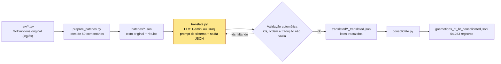

---
language:
- pt
- en
license: apache-2.0
task_categories:
- text-classification
task_ids:
- multi-label-classification
pretty_name: GoEmotions pt-BR
size_categories:
- 10K<n<100K
tags:
- emotion
- portuguese
- translation
- reddit
---

# GoEmotions em Português (pt-BR)

Dataset de classificação de emoções em português do Brasil: tradução dos 54.263 comentários do Reddit do [GoEmotions](https://github.com/google-research/google-research/tree/master/goemotions) (28 rótulos de emoção), feita com modelos de linguagem por um pipeline em Python com validação automática.

> **Status:** completo. Todos os 54.263 comentários do GoEmotions (treino, validação e teste) estão traduzidos. Veja [Status da tradução](#status-da-tradução).

## Sumário

- [O problema](#o-problema)
- [Como funciona](#como-funciona)
- [Stack](#stack)
- [Meu papel](#meu-papel)
- [Contexto](#contexto)
- [Próximos passos](#próximos-passos)
- [Como rodar](#como-rodar)
- [Estrutura do repositório](#estrutura-do-repositório)
- [Formato dos dados](#formato-dos-dados)
- [Rótulos de emoção](#rótulos-de-emoção)
- [Estatísticas](#estatísticas)
- [Status da tradução](#status-da-tradução)
- [Limitações e cuidados](#limitações-e-cuidados)
- [Licença](#licença)
- [Citação](#citação)
- [Agradecimentos](#agradecimentos)

## O problema

O GoEmotions é um dos principais datasets de emoções refinadas, mas seus textos existem apenas em inglês. Para treinar e avaliar classificadores de emoção em português do Brasil faltam dados com essa granularidade (28 rótulos) e com o registro informal típico da internet. Este projeto traduz cada comentário para pt-BR, mantendo o tom, as gírias e a intensidade emocional do original, para que os mesmos rótulos possam ser usados em português.

## Como funciona

O pipeline lê os TSVs originais, divide os comentários em lotes de 50, envia cada lote a um modelo de linguagem com um prompt de sistema e valida a resposta antes de gravar. Por fim, junta todos os lotes em um único arquivo `.jsonl`.



O LLM entra apenas na etapa de `translate.py` (destacada no diagrama). As demais etapas são determinísticas.

Como a tradução é feita:

- **Lotes de 50.** `prepare_batches.py` divide cada TSV (`train`, `dev`, `test`) em lotes de 50 comentários, preservando `id`, `split`, `line_idx`, texto original e rótulos.
- **Provedores.** `translate.py` suporta a API do Gemini (padrão) e a do Groq (`--provider groq`). Cada lote vai em uma requisição.
- **Prompt de sistema.** Pede tradução natural e adaptada, não literal; preserva tom, emoção, registro, gírias, sarcasmo, xingamentos e intensidade; adapta expressões idiomáticas para equivalentes brasileiros; mantém tokens como `[NAME]` e `[RELIGION]` exatamente como estão; preserva emojis, emoticons, caixa alta e pontuação expressiva; não censura nem suaviza; trata cada item como independente.
- **Saída JSON.** O modelo responde apenas com `{"items": [{"id": "...", "t": "tradução"}, ...]}`, um objeto por item, com o mesmo `id`. No Gemini a resposta segue um schema JSON; no Groq usa-se o modo `json_object`.
- **Validação automática.** Cada item é conferido por `id`, e traduções ausentes ou vazias são rejeitadas. Em caso de erro, o script tenta de novo com espera crescente (backoff) e pede novamente só os `id`s que faltaram. Lotes já traduzidos são pulados, então a execução pode ser retomada.
- **Último grupo.** Os 11.913 registros traduzidos por `gemini-3.8-flash-low` foram feitos por um agente de linha de comando (`agy`), lote a lote, seguindo as mesmas regras de tradução do `translate.py`, e validados da mesma forma: mesmos ids, mesma ordem e nenhuma tradução vazia.
- **Consolidação.** `consolidate.py` junta os lotes traduzidos em `translated/goemotions_pt_br_consolidated.jsonl`.

Os rótulos de emoção, os identificadores e a divisão treino/validação/teste são os do dataset original. Nenhum rótulo foi alterado. O campo `translator` indica o modelo usado em cada registro; registros sem esse campo foram traduzidos por um modelo anterior do Gemini (`gemini-3.1-flash-lite`).

## Stack

- Python 3.8+ usando somente a biblioteca padrão (`urllib`, `json`, `csv`, `argparse`), sem dependências externas.
- APIs de LLM: Gemini (Google) e Groq (`openai/gpt-oss-120b`).
- CLI de agente (`agy`) com `gemini-3.8-flash-low`, para o último grupo de lotes.
- Formatos: TSV (entrada), JSON (lotes) e JSON Lines (saída final).
- Metadados no padrão de dataset card do Hugging Face (front matter YAML no topo deste arquivo).

## Meu papel

Fui responsável pelo pipeline e pela montagem do dataset:

- o pipeline de tradução: geração de lotes (`prepare_batches.py`), tradução com Gemini e Groq (`translate.py`) e consolidação (`consolidate.py`);
- a execução das traduções e a adição dos lotes traduzidos, incluindo o suporte ao provedor Groq;
- o arquivo consolidado `translated/goemotions_pt_br_consolidated.jsonl`;
- o README e a licença Apache 2.0.

O Pull Request #1 (suporte ao Groq e novos lotes) foi integrado ao repositório da organização por Vitória Ferreira.

## Contexto

Projeto da Residência em IA, Formação avançada em Inteligência Artificial (PUCC e Instituto de Pesquisas Eldorado), desenvolvido na organização Equilibrium-Residencia-IA. Mais informações sobre o programa: <https://formacao.eldorado.org.br/residencia-ia-pucc>.

## Próximos passos

- Análise exploratória dos dados (EDA) do dataset traduzido.
- Publicação no Hugging Face e no Kaggle.

Ambos estão planejados e ainda não foram feitos.

## Como rodar

Requisitos: Python 3.8+ (somente biblioteca padrão) e uma chave de API do Gemini ([aistudio.google.com/apikey](https://aistudio.google.com/apikey)) ou do Groq.

```bash
# 1. Defina a chave (ou coloque GEMINI_API_KEY=... em um arquivo .env, que não é versionado)
export GEMINI_API_KEY=sua_chave

# 2. Gere os lotes: <split> <tamanho do lote> <máximo de lotes, 0 = todos>
python prepare_batches.py train 50 0
python prepare_batches.py dev 50 0
python prepare_batches.py test 50 0

# 3. Traduza (pula lotes já traduzidos, então pode ser reexecutado para retomar)
python translate.py
# Para testar com poucos lotes:
python translate.py --pattern "dev_*" --limit 2

# 4. Consolide em um único arquivo .jsonl
python consolidate.py
```

O provedor padrão é o Gemini (`gemini-3.5-flash-lite`). Para usar o Groq, passe `--provider groq` e defina `GROQ_API_KEY` (modelo padrão `openai/gpt-oss-120b`). O modelo pode ser trocado com `--model` ou pelas variáveis `GEMINI_MODEL` / `GROQ_MODEL`. O script espera e tenta de novo automaticamente em caso de erro temporário; lotes que falharem são registrados em `translated/failed_batches.txt` e podem ser refeitos reexecutando `translate.py`. A execução completa pode levar horas.

## Estrutura do repositório

```
.
├── raw/                  # Dados originais do GoEmotions (inglês)
│   ├── train.tsv         # Treino
│   ├── dev.tsv           # Validação
│   ├── test.tsv          # Teste
│   └── emotions.txt      # Lista dos 28 rótulos, na ordem dos índices
├── batches/              # Lotes intermediários (texto original + rótulos), gerados por prepare_batches.py
├── translated/           # Lotes traduzidos, um arquivo por lote (*_translated.json)
│   ├── failed_batches.txt                        # Registro histórico das falhas de tradução (todas já reprocessadas)
│   └── goemotions_pt_br_consolidated.jsonl       # Arquivo único gerado por consolidate.py
├── prepare_batches.py    # Divide os TSVs originais em lotes
├── translate.py          # Traduz os lotes com a API do Gemini ou do Groq
├── consolidate.py        # Junta os lotes traduzidos em um .jsonl
├── LICENSE               # Apache License 2.0
└── README.md
```

## Formato dos dados

O arquivo final é um JSON Lines (`.jsonl`), com um comentário por linha:

```json
{
  "id": "edgurhb",
  "split": "dev",
  "line_idx": 0,
  "original_text": "Is this in New Orleans?? I really feel like this is New Orleans.",
  "emotion_ids": "27",
  "emotions": ["neutral"],
  "translated_text": "Isso é em Nova Orleans?? Tenho muita pinta de ser em Nova Orleans.",
  "translator": "gemini-3.8-flash-low"
}
```

| Campo | Tipo | Descrição |
|---|---|---|
| `id` | string | Identificador do comentário no Reddit (igual ao do GoEmotions original). |
| `split` | string | Divisão original: `train`, `dev` ou `test`. |
| `line_idx` | int | Posição da linha no TSV original da divisão (0-based). |
| `original_text` | string | Texto original em inglês. |
| `emotion_ids` | string | Índices dos rótulos, separados por vírgula (ex.: `"4,27"`). Veja [Rótulos de emoção](#rótulos-de-emoção). |
| `emotions` | lista de string | Nomes dos rótulos correspondentes a `emotion_ids`. |
| `translated_text` | string | Tradução para pt-BR. |
| `translator` | string | Modelo que fez a tradução. Ausente em 23.950 registros (veja [Status da tradução](#status-da-tradução)). |

Um mesmo comentário pode ter mais de um rótulo, como no original.

## Rótulos de emoção

| Índice | Rótulo | Índice | Rótulo |
|---|---|---|---|
| 0 | admiration | 14 | fear |
| 1 | amusement | 15 | gratitude |
| 2 | anger | 16 | grief |
| 3 | annoyance | 17 | joy |
| 4 | approval | 18 | love |
| 5 | caring | 19 | nervousness |
| 6 | confusion | 20 | optimism |
| 7 | curiosity | 21 | pride |
| 8 | desire | 22 | realization |
| 9 | disappointment | 23 | relief |
| 10 | disapproval | 24 | remorse |
| 11 | disgust | 25 | sadness |
| 12 | embarrassment | 26 | surprise |
| 13 | excitement | 27 | neutral |

## Estatísticas

Número de comentários por divisão (igual ao original e ao arquivo final):

| Divisão | Comentários |
|---|---|
| train | 43.410 |
| dev | 5.426 |
| test | 5.427 |
| **Total** | **54.263** |

Um mesmo comentário pode ter mais de um rótulo, então a soma das frequências por rótulo é maior que o total de comentários. Comentários com mais de um rótulo: 8.817.

Frequência de cada rótulo no arquivo final:

| Rótulo | Comentários | Rótulo | Comentários |
|---|---|---|---|
| neutral | 17.772 | fear | 764 |
| admiration | 5.122 | remorse | 669 |
| approval | 3.687 | embarrassment | 375 |
| gratitude | 3.372 | nervousness | 208 |
| annoyance | 3.093 | relief | 182 |
| amusement | 2.895 | pride | 142 |
| curiosity | 2.723 | grief | 96 |
| disapproval | 2.581 | desire | 801 |
| love | 2.576 | disgust | 1.013 |
| optimism | 1.976 | excitement | 1.052 |
| anger | 1.960 | surprise | 1.330 |
| joy | 1.785 | caring | 1.375 |
| confusion | 1.673 | realization | 1.382 |
| sadness | 1.625 | disappointment | 1.583 |

## Status da tradução

**Tradução completa:** os 54.263 comentários estão traduzidos e consolidados em `translated/goemotions_pt_br_consolidated.jsonl`. Na validação final, todos os registros batem com os TSVs originais (id e texto), não há traduções vazias e não há identificadores duplicados.

Quem traduziu cada registro (campo `translator`):

| Modelo (`translator`) | Registros | Divisão | Como foi executado |
|---|---|---|---|
| *(ausente)* → `gemini-3.1-flash-lite` | 23.950 | train (23.750), dev (200) | `translate.py`, com o modelo anterior do Gemini |
| `gemini-3.5-flash-lite` | 17.000 | train | `translate.py` |
| `openai/gpt-oss-120b` | 1.400 | train | `translate.py --provider groq` |
| `gemini-3.8-flash-low` | 11.913 | train (1.260), dev (5.226), test (5.427) | CLI de agente `agy` com o modelo `gemini-3.8-flash-low`, lote a lote |

Os lotes do último grupo foram traduzidos por um agente, lote a lote, seguindo as mesmas regras de tradução do `translate.py`, e validados automaticamente (mesmos ids, mesma ordem, nenhuma tradução vazia).

O arquivo `translated/failed_batches.txt` é um registro histórico das falhas das primeiras execuções. Todos esses lotes foram traduzidos depois.

Para regenerar o arquivo consolidado a partir dos lotes, rode `python consolidate.py`.

## Limitações e cuidados

- **Tradução automática, sem revisão humana.** Erros de tradução e de nuance emocional são esperados. Quem usar o dataset deve avaliar a qualidade na tarefa específica.
- **Mistura de tradutores.** Os registros foram traduzidos por modelos diferentes (veja [Status da tradução](#status-da-tradução)). Estilo e qualidade podem variar entre as divisões e entre os grupos. Use o campo `translator` para filtrar, se necessário.
- **Rótulos herdados do original.** As anotações foram feitas em inglês, por anotadores de uma cultura específica. Elas podem não corresponder à percepção de falantes de português.
- **Conteúdo sensível.** Os textos vêm do Reddit e podem conter linguagem ofensiva, xingamentos e conteúdo adulto. Os dados foram mantidos como no original, sem censura.
- **Dados pessoais.** O GoEmotions original já substituiu nomes e menções por tokens como `[NAME]` e `[RELIGION]`. Esses tokens são mantidos na tradução.
- **Viés do modelo.** A tradução reflete os vieses dos modelos usados.

## Licença

Este projeto é distribuído sob a [Apache License 2.0](LICENSE), a mesma licença do GoEmotions original.

A licença do GoEmotions original está em <https://huggingface.co/datasets/google-research-datasets/go_emotions> e <https://github.com/google-research/google-research/blob/master/LICENSE>. Ao redistribuir, mantenha a atribuição ao projeto original (veja [Citação](#citação)).

Os textos originais são comentários públicos do Reddit. Antes de usar este dataset comercialmente, confira os termos de uso do Reddit.

## Citação

Se você usar este dataset, cite o trabalho original do GoEmotions:

```bibtex
@inproceedings{demszky2020goemotions,
  author    = {Demszky, Dorottya and Movshovitz-Attias, Dana and Ko, Jeongwoo and Cowen, Alan and Nemade, Gaurav and Ravi, Sujith},
  title     = {{GoEmotions}: A Dataset of Fine-Grained Emotions},
  booktitle = {Proceedings of the 58th Annual Meeting of the Association for Computational Linguistics},
  year      = {2020},
  url       = {https://arxiv.org/abs/2005.00547}
}
```

## Agradecimentos

Aos autores do GoEmotions (Google Research), pelo dataset original.
